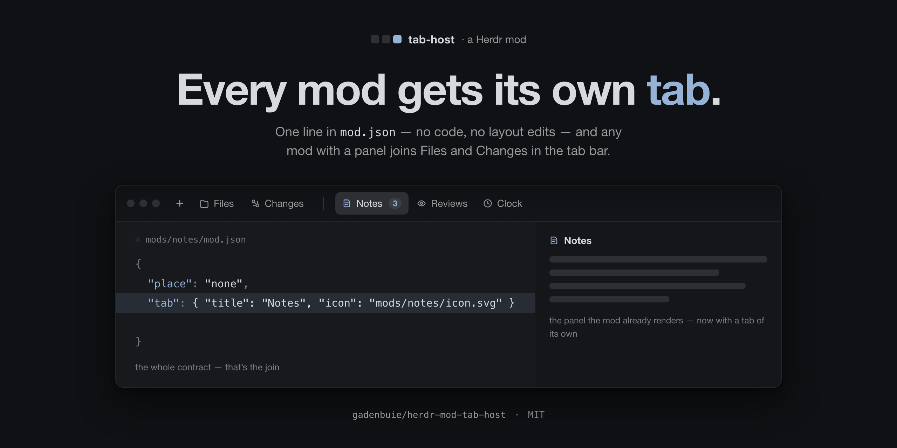

# Tab host

A shared tab section for the [Herdr](https://herdr.dev) desktop app
(`herdr-app`; written against 0.1.12): every mod gets its own
button in the tab bar, next to Files and Changes, without one big mod and
without one layout variant per mod.



The layout gives the tab bar one extra block:

```json
{
  "id": "tab-bar",
  "type": "row",
  "size": { "px": 42 },
  "resizable": false,
  "children": [
    { "id": "tabs", "type": "block", "content": { "mod": "tabs" }, "window_drag": true },
    {
      "id": "tabhost-buttons",
      "type": "block",
      "size": { "px": 90 },
      "window_drag": true,
      "content": {
        "mod": "tab-host",
        "props": { "stack": "panel-body", "panel": "panel", "buttons": true }
      }
    }
  ]
}
```

A mod joins by declaring a tab in its own `mod.json` — no code, no
registration, no layout edit:

```json
{ "place": "none", "tab": { "title": "Notes", "icon": "mods/<name>/icon.svg" } }
```

Installing that mod is the whole act: `tab-host` adds its block to the side
panel's stack (`layout.set`), the tab bar draws its button, and the button
opens the panel on that tab exactly as the Files and Changes buttons do.
Uninstalling the mod takes both away again.

- `mods/tab-host/` — the buttons and the reconciler.
- `examples/tab-notes/` — the example contributor: a scratchpad that saves
  as you type, and proof that a `tab` in `mod.json` is the entire contract.

## Install

```sh
git clone https://github.com/gadenbuie/herdr-mod-tab-host.git
cd herdr-mod-tab-host
./install.sh
```

`install.sh` copies this repo's mods — tab-host alone; the example stays in
`examples/` — into `~/.config/herdr-app/mods/`, **wires every personal
layout** (`wire.py` — each layout's tab bar gains the block above,
idempotently, with a backup beside the file), and runs `herdr-app check` on
each mod. To watch the whole flow live, copy the example contributor in by
hand:

```sh
rsync -rlpt --delete examples/tab-notes/ ~/.config/herdr-app/mods/tab-notes/
```

Shipped layouts are left alone: Herdr refuses structural changes there and
replaces them at start, so tab-host lives in the layouts the person owns.
The copy is deliberate: Herdr (0.1.12) doesn't run mods that live behind a
symlinked mod folder, so a `git pull` reaches the app through one run of
`install.sh`. Third-party contributors don't come through this script — they
install themselves (see "Writing a contributor").

## Writing a contributor

A contributor is **someone else's mod** — its own folder, its own repo, its
own install step — that joins by declaring a tab in its own `mod.json`.
Every field but `title` is optional, and the same field under the name
`button` works too (herdrdev/herdr-app#246):

| Field | What it does |
| ----- | ----------- |
| `tab.title` | The button's label. |
| `tab.icon` | A path from Herdr's home (`mods/<name>/icon.svg`); `*.svg` draws tinted with the text color, anything else full color. |
| `tab.badge` | A count the contributor publishes on a `shared()` key; drawn as a chip after the label. |
| `tab.order` | A number, smaller further left. Missing sorts as 100, ties fall back to the title — contributors among themselves only. |
| `tab.show` | A shell string, run as `sh -c` in the shown space's folder on that space's machine; exit 0 draws the button. Absent draws always. |
| `tab.state` | A `shared()` key the contributor keeps its live state in; tab-host keeps one value of it per space, so the state sticks to the workspace. |

Installing the contributor into `~/.config/herdr-app/mods/<name>/` as a real
directory is the whole act; tab-host adds the button and the block the moment
the folder lands, and removes them when it goes. A contributor should still
be worth having without tab-host — as a pane via `pane.split --mod <name>`,
the way herdr-issues opens.

**AGENTS.md** in this repo is the full contract for the agents who build
those mods, and **PROMPT.md** holds the one-line prompt a person pastes to
send an agent at it. `examples/tab-notes/` here is the reference example;
third parties copy its shape, not its folder.

### Badges

**`tab.badge: "<shared key>"`** — a count the contributor keeps up to date
with `setShared` (setting it re-renders every mod). The button draws it as a
chip after its label and after the part that truncates, so a narrow tab bar
shortens the title and keeps the number. That is what makes an unread count
visible while the side panel is collapsed, which is where it spends its
time. tab-host never counts anything itself: a missing, zero or non-numeric
value draws nothing.

### Conditional buttons

**`tab.show`** is for a contributor whose program is not everywhere: a
shell string, run as `sh -c` in the shown space's folder on that space's
machine. Exit 0 draws the button; a nonzero exit, or an exec that can't
start (the program isn't there, the machine is away), keeps it away. Absent
draws always. So roborev's manifest can say
`"show": "command -v roborev >/dev/null 2>&1"` and the button appears in
the spaces whose machine has it — one bar, several spaces, and a button
that means something in each. Every answer is remembered for its space, in
`localStorage`, so a restart keeps it: coming back to a space draws its
buttons at once while the check runs again behind them, and only an answer
that changed takes one away. A space nobody has visited yet has no answer to
draw from, so it draws the button and takes it away only if that space's own
answer says no — the bar never empties itself on a space change, and a
remote space doesn't spend a round trip without its buttons. tab-host logs
every answer as `show roborev → no (code 1)` in `reconcile.log`, so a button
that doesn't appear can be looked up rather than guessed at.

Each space also comes back to the tab it had open: a tab contributed here
that was showing when the person left a space is selected and shown again
when they return, which the one shared panel column cannot do on its own.

### State that sticks to the space

**`tab.state: "<shared key>"`** — for a panel whose view belongs to the
workspace, like an inbox with the thread the person opened: name a
`shared()` key, keep your live state in it (write with `setShared` on every
change, read in `render()`, treat `null` as fresh), and tab-host keeps one
value of it per space. Switching spaces hands the arriving one its own back
— keyed the same `id + machine + folder` way the open-tab memory is, so the
state follows the space and comes back when the person does. The
contributor's own copy is out of the loop, asleep or awake: a shared key is
the one thing that can change hands without it, and the moment a space
changes is exactly when its tab may be hidden — which is why the carry
lives here rather than in the contributor. Keep the key yours
(`<mod>.state`) and the value small JSON; an entry past 32 KiB is dropped
(one file holds every space's every contributor). Each carry is a line in
`reconcile.log`, `state <space> → <space>`.

### A key for a tab

**`tab-host.toggle:<mod>`** — a command to bind to a key, e.g.
`"cmd-alt-shift-i": "tab-host.toggle:tab-notes"` in `keys.json`. It toggles
that mod's tab: the panel opens on it, and the same press again puts the
panel away — the button's own behaviour, so a key and a click can't drift
apart. `tab-host` there is this mod's own folder name, the same way
`plannotator.palette` names that mod; Herdr hands the part after the dot —
`toggle:<mod>` — to this copy's `nextCommand()` (`open:<mod>`, the name this
had in its first cut, still answers). It has to live here: `keys.json` fills
only a command's first argument, so neither `layout.select` (two arguments)
nor the `layout.show` after it can be bound, and a contributor's own copy is
asleep whenever its tab is hidden — which is exactly when someone wants the
key. A tab `tab.show` keeps out of the space being shown refuses the press
too: the button isn't there, so the key has nothing to open.

### Tabs without a manifest

`herdr`'s `shared("tabhost.panels")` is a second door: a list of extra mod
names (set with `setShared`, or edited into `shared.json`) for a mod that
should appear without a manifest.

## Mod or layout?

A mod, wired into the person's layouts — not a layout of its own in
Settings. A tab-host layout would be a frozen clone of some base that drifts
on every Herdr update (the trap herdrdev/herdr-app#246 describes), and
layouts are either/or: picking it would mean leaving your own. The block
`wire.py` adds is one idempotent edit per personal layout, and contributors
then join forever without touching a layout. When the core takes this over
(#246), its buttons work on shipped layouts too, and this mod's reconciler
retires without its contributors noticing.

## Notes

- `tab` or `button`: herdrdev/herdr-app#246 proposes a `button` key in
  `mod.json` for the same idea, done by the app itself (blocks injected into
  every `panel-body` stack, buttons drawn by the shipped tab bar). This mod
  accepts either key, so a contributor written today keeps working if the
  core takes the idea over; at that point the reconciler has nothing to add
  (blocks already in the stack are kept) and the buttons keep drawing.
- Diagnostics land in `~/.config/herdr-app/data/tab-host/reconcile.log` —
  copy starts, the tabs each reconcile saw, every `layout.set` and resize,
  and each `tab-host.toggle:<mod>` a key sent.
- The buttons block sits at the right end of the tab bar; on Linux and
  Windows the shipped tab bar draws the window buttons there too, so the
  buttons land outside them (same as herdr-issues' button block).
